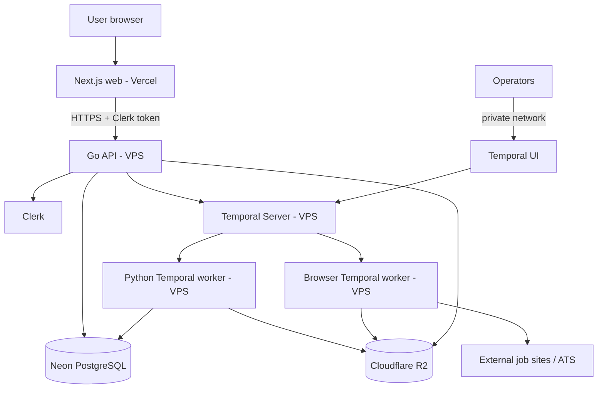

# go-get-job — System Architecture

**Status:** Proposed target architecture  
**Decision baseline:** Neon + Clerk; fresh database; Go API; Next.js web; Temporal; Python and browser workers.

## 1. Goals

Build a public, multi-user product while preserving the useful automation capabilities already developed for the single-user system. The first release should provide job discovery through application tracking, with explicit human approval before an application is submitted.

Non-goals for the initial release:
- Rewriting every existing Python automation in Go.
- Splitting the Go API into microservices.
- Unattended application submission for public users.
- Migrating the entire existing Supabase database and its history.

## 2. High-level topology

The API authenticates the caller, enforces authorization, performs short database operations, and starts or signals workflows. Temporal persists workflow state and coordinates asynchronous work. Workers poll task queues and execute activities.

## 3. Deployable application components

| Deployable | Responsibility | Runtime |
|---|---|---|
| `web` | User interface, forms, review queues, application views | Next.js on Vercel |
| `api` | Authentication verification, authorization, business rules, REST API | Go on VPS |
| `worker-python` | Existing Python scraping, matching, LLM, document activities where appropriate | Python on VPS |
| `worker-browser` | Playwright/browser automation, isolated from general Python activities | Python/Playwright on VPS |

These are four logical application deployables. They may share repository packages and infrastructure, but should run as separate processes/containers so they can be deployed, restarted, scaled, and resource-limited independently.

Temporal Server, Temporal UI, Temporal persistence DB, Neon, R2, Caddy, and monitoring are infrastructure services.

## 4. Backend shape

Use a **Go modular monolith**. Suggested modules:

- `identity`: Clerk identity mapping and current-user context.
- `profiles`: user profile and preferences.
- `skills`: normalized skills and skill gaps.
- `jobs`: shared job listing pool and source ingestion.
- `evaluations`: per-user job evaluation history.
- `applications`: application lifecycle and transitions.
- `documents`: CV and cover-letter metadata and R2 references.
- `activities`: audit/activity timeline.
- `workflows`: Temporal client, workflow starts, signals, and status views.
- `admin`: restricted operational endpoints.

Modules can share one process and one database while keeping package boundaries explicit. Do not introduce microservices just to mirror the module names.

## 5. Request and background-work flow

1. The browser signs in through Clerk and obtains a session token.
2. The browser calls the Go API with the token.
3. Go verifies the token and resolves it to an internal user record.
4. Go authorizes the requested resource using the authenticated internal user ID.
5. For short work, Go performs the transaction and returns a response.
6. For long work, Go starts a Temporal workflow and returns `202 Accepted` with a workflow identifier.
7. Workers execute activities and persist results to Neon/R2.
8. The browser reads workflow/application state through the API.

The web app must not connect directly to Neon. Core business rules must not live only in Next.js route handlers or server actions.

## 6. Database and storage

- **Neon PostgreSQL:** system of record for users, profiles, skills, shared jobs, evaluations, applications, documents metadata, and activities.
- **Cloudflare R2:** binary files such as generated CVs and other application documents. Store object keys and metadata in Neon.
- **Temporal persistence DB:** Temporal's own workflow/history persistence. It is separate from the application database.
- **Redis:** not required initially. Add only when a measured requirement exists (for example, distributed rate limiting or caching).

## 7. Existing system transition

The existing Supabase database and automation are the legacy baseline. Create a fresh Neon schema. Do not perform a wholesale database copy. Selectively import only explicitly approved seed data, such as the owner's profile, skills, or a curated job subset, if useful.

Migrate writers and readers deliberately. Avoid prolonged dual-writing to Supabase and Neon because it creates consistency and recovery problems. During cutover, designate one system as the source of truth for each data domain.

## 8. Architectural constraints

- Every user-owned query and mutation must be tenant-scoped.
- Shared job listings must not contain a user's verdict or application status.
- Re-evaluation creates a new evaluation/verdict record; retrying the same evaluation must be idempotent.
- Workflow IDs must be stable and meaningful; activities must be retry-safe.
- Browser automation must be isolated from public HTTP request handling.
- Temporal UI, database ports, worker ports, and internal admin endpoints must not be publicly exposed.
