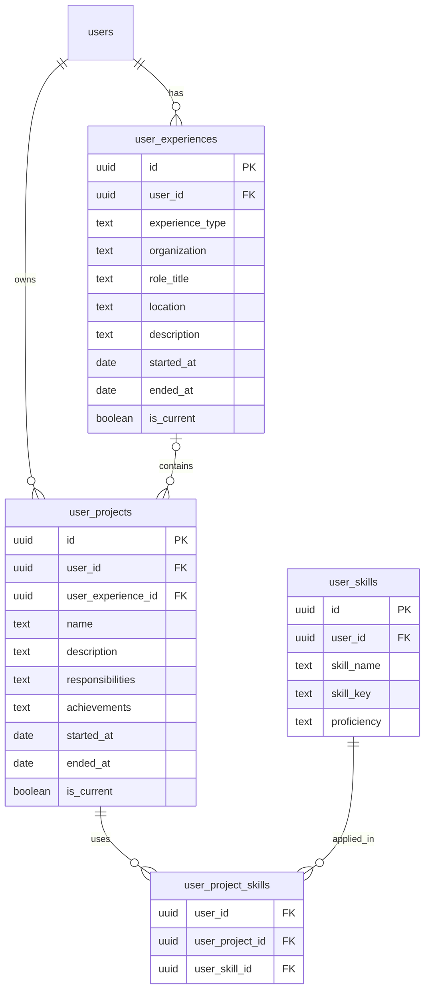

# User Experiences, Projects, and Project Skills Data Model

## 1. Purpose

This document defines how go-get-job stores a user's career history and the actual work they have done.

The model separates four concepts:

1. **User skills** — the user's skill inventory and self-assessed proficiency. The `user_skills` table already exists.
2. **User experiences** — where the user worked or gained experience, their role, and the overall time period.
3. **User projects** — the actual projects, initiatives, or meaningful pieces of work completed within an experience.
4. **User project skills** — the skills the user applied in each project.

> Store an employment experience once. Store each project once. Link the skills used in each project.

This avoids repeating the same employer, job title, and employment dates for every skill.

## 2. Example: Amartha

Suppose a user worked at Amartha as a Backend Engineer from April 2023 to the present.

That employment is one `user_experiences` row:

| Organization | Role | Period |
|---|---|---|
| Amartha | Backend Engineer | Apr 2023 – Present |

The user may have worked on several projects or initiatives during that employment:

| Project | Description |
|---|---|
| Transaction Store Revamp | Revamping transaction store processing using a message broker |
| Legacy Wallet Knowledge Transfer | Helping the new team understand legacy wallet functionality, including auto-debit and balance transfers |
| Promo Page | Preparing the technical requirements document for a promotional page |

Each project has its own description, personal responsibilities, achievements, dates, and associated skills.

For example, Transaction Store Revamp might be linked to Go, Kafka, and PostgreSQL. The skills linked to other projects can be different.

These project examples are illustrative. Actual responsibilities, technologies, dates, and outcomes should be entered based on what the user confirms.

## 3. Entity relationship



`user_experience_id` is nullable on `user_projects`. This allows a standalone project, such as a personal project, that is not associated with an employment record.

## 4. Table: `user_experiences`

One row represents one employment or other experience in the user's career history.

| Column | Type | Nullable | Description |
|---|---|---:|---|
| `id` | `UUID` | No | Primary key |
| `user_id` | `UUID` | No | Owner; references `users(id)` |
| `experience_type` | `TEXT` | No | `professional`, `freelance`, `internship`, `volunteer`, or `other` |
| `organization` | `TEXT` | Yes | Employer or organization name |
| `role_title` | `TEXT` | Yes | Position or role, e.g. Backend Engineer |
| `location` | `TEXT` | Yes | Work location, if relevant |
| `description` | `TEXT` | Yes | General description of the role or experience |
| `started_at` | `DATE` | Yes | Start date, if known |
| `ended_at` | `DATE` | Yes | End date, if known |
| `is_current` | `BOOLEAN` | No | Whether the experience is ongoing |
| `created_at` | `TIMESTAMPTZ` | No | Record creation time |
| `updated_at` | `TIMESTAMPTZ` | No | Last update time |

### Notes

- One row represents one employer/role period, not one project.
- A user can have multiple experiences at the same organization if they held different roles or had separate employment periods.
- Dates are nullable when the user does not know the exact dates.
- An ongoing experience must not have an `ended_at` value.

## 5. Table: `user_projects`

One row represents a project, initiative, or meaningful piece of work.

A project can be associated with a `user_experiences` record. It can also be standalone by leaving `user_experience_id` null.

| Column | Type | Nullable | Description |
|---|---|---:|---|
| `id` | `UUID` | No | Primary key |
| `user_id` | `UUID` | No | Owner; references `users(id)` |
| `user_experience_id` | `UUID` | Yes | Related employment/experience; null for standalone projects |
| `name` | `TEXT` | No | Project or initiative name |
| `description` | `TEXT` | Yes | What the project is, the problem it addresses, and its context |
| `responsibilities` | `TEXT` | Yes | What the user personally did or contributed |
| `achievements` | `TEXT` | Yes | Delivered outcomes, improvements, or measurable impact |
| `started_at` | `DATE` | Yes | Project start date, if known |
| `ended_at` | `DATE` | Yes | Project end date, if known |
| `is_current` | `BOOLEAN` | No | Whether the project is ongoing |
| `created_at` | `TIMESTAMPTZ` | No | Record creation time |
| `updated_at` | `TIMESTAMPTZ` | No | Last update time |

### Description, responsibilities, and achievements

Keep these concepts distinct:

- **Description:** What was the project or problem?
- **Responsibilities:** What did the user personally do?
- **Achievements:** What was delivered or improved as a result?

Example:

- Description: Revamping the transaction store process to improve transaction processing.
- Responsibilities: Designed and implemented backend changes to move transaction processing through a message broker.
- Achievements: Record the actual measured result when known. Do not invent an impact metric.

These fields can later be used by AI to create relevant CV bullet points. The user should be able to review and edit AI-generated content.

## 6. Table: `user_project_skills`

This junction table connects projects to the existing `user_skills` table.

It represents which skills the user applied in a particular project:
- One project can use many skills.
- One skill can be used in many projects.

| Column | Type | Nullable | Description |
|---|---|---:|---|
| `user_id` | `UUID` | No | Owner; used to enforce ownership consistency |
| `user_project_id` | `UUID` | No | Related project |
| `user_skill_id` | `UUID` | No | Related skill |
| `created_at` | `TIMESTAMPTZ` | No | Link creation time |

Composite foreign keys ensure that a project and its linked skill belong to the same user.

## 7. PostgreSQL migration

This migration assumes:

- `users` already exists with `id UUID PRIMARY KEY`.
- `user_skills` already exists.
- `user_skills` has a unique constraint on `(id, user_id)`, as specified in the existing skills data model.
- The project already has a shared `trigger_updated_at()` function.

```sql
CREATE TABLE user_experiences (
    id UUID PRIMARY KEY DEFAULT gen_random_uuid(),
    user_id UUID NOT NULL REFERENCES users(id) ON DELETE RESTRICT,

    experience_type TEXT NOT NULL
        CHECK (experience_type IN (
            'professional',
            'freelance',
            'internship',
            'volunteer',
            'other'
        )),

    organization TEXT,
    role_title TEXT,
    location TEXT,
    description TEXT,

    started_at DATE,
    ended_at DATE,
    is_current BOOLEAN NOT NULL DEFAULT FALSE,

    created_at TIMESTAMPTZ NOT NULL DEFAULT NOW(),
    updated_at TIMESTAMPTZ NOT NULL DEFAULT NOW(),

    CONSTRAINT uq_user_experiences_id_user
        UNIQUE (id, user_id),

    CONSTRAINT chk_user_experiences_date_range
        CHECK (
            started_at IS NULL
            OR ended_at IS NULL
            OR ended_at >= started_at
        ),

    CONSTRAINT chk_user_experiences_current_end
        CHECK (NOT is_current OR ended_at IS NULL)
);

CREATE INDEX idx_user_experiences_user
    ON user_experiences (user_id, started_at DESC);

CREATE TRIGGER trg_user_experiences_updated_at
    BEFORE UPDATE ON user_experiences
    FOR EACH ROW EXECUTE FUNCTION trigger_updated_at();


CREATE TABLE user_projects (
    id UUID PRIMARY KEY DEFAULT gen_random_uuid(),
    user_id UUID NOT NULL REFERENCES users(id) ON DELETE RESTRICT,

    user_experience_id UUID,

    name TEXT NOT NULL
        CHECK (BTRIM(name) <> ''),

    description TEXT,
    responsibilities TEXT,
    achievements TEXT,

    started_at DATE,
    ended_at DATE,
    is_current BOOLEAN NOT NULL DEFAULT FALSE,

    created_at TIMESTAMPTZ NOT NULL DEFAULT NOW(),
    updated_at TIMESTAMPTZ NOT NULL DEFAULT NOW(),

    CONSTRAINT uq_user_projects_id_user
        UNIQUE (id, user_id),

    CONSTRAINT fk_user_projects_experience_owner
        FOREIGN KEY (user_experience_id, user_id)
        REFERENCES user_experiences (id, user_id)
        ON DELETE RESTRICT,

    CONSTRAINT chk_user_projects_date_range
        CHECK (
            started_at IS NULL
            OR ended_at IS NULL
            OR ended_at >= started_at
        ),

    CONSTRAINT chk_user_projects_current_end
        CHECK (NOT is_current OR ended_at IS NULL)
);

CREATE INDEX idx_user_projects_user
    ON user_projects (user_id, started_at DESC);

CREATE INDEX idx_user_projects_experience
    ON user_projects (user_experience_id);

CREATE TRIGGER trg_user_projects_updated_at
    BEFORE UPDATE ON user_projects
    FOR EACH ROW EXECUTE FUNCTION trigger_updated_at();


CREATE TABLE user_project_skills (
    user_id UUID NOT NULL REFERENCES users(id) ON DELETE RESTRICT,
    user_project_id UUID NOT NULL,
    user_skill_id UUID NOT NULL,

    created_at TIMESTAMPTZ NOT NULL DEFAULT NOW(),

    PRIMARY KEY (user_project_id, user_skill_id),

    CONSTRAINT fk_project_skills_project_owner
        FOREIGN KEY (user_project_id, user_id)
        REFERENCES user_projects (id, user_id)
        ON DELETE RESTRICT,

    CONSTRAINT fk_project_skills_skill_owner
        FOREIGN KEY (user_skill_id, user_id)
        REFERENCES user_skills (id, user_id)
        ON DELETE RESTRICT
);

CREATE INDEX idx_user_project_skills_skill
    ON user_project_skills (user_skill_id);

CREATE INDEX idx_user_project_skills_user
    ON user_project_skills (user_id);
```

## 8. Example records

The following IDs are illustrative.

### `user_experiences`

| ID | Organization | Role | Period |
|---|---|---|---|
| E1 | Amartha | Backend Engineer | Apr 2023 – Present |
| E2 | Sinarmas Mining | Backend Engineer | Jan 2021 – Jan 2022 |

### `user_projects`

| ID | Experience | Project |
|---|---|---|
| P1 | E1 — Amartha | Transaction Store Revamp |
| P2 | E1 — Amartha | Legacy Wallet Knowledge Transfer |
| P3 | E1 — Amartha | Promo Page |
| P4 | E2 — Sinarmas Mining | Mining Backend System |
| P5 | None | Personal Backend Project |

### `user_skills`

| ID | Skill |
|---|---|
| S1 | Go |
| S2 | PostgreSQL |
| S3 | Kafka |
| S4 | Redis |

### `user_project_skills`

| Project | Skill |
|---|---|
| P1 — Transaction Store Revamp | Go |
| P1 — Transaction Store Revamp | Kafka |
| P1 — Transaction Store Revamp | PostgreSQL |
| P2 — Legacy Wallet Knowledge Transfer | Go |
| P2 — Legacy Wallet Knowledge Transfer | PostgreSQL |
| P3 — Promo Page | Go |
| P4 — Mining Backend System | Go |
| P5 — Personal Backend Project | Go |
| P5 — Personal Backend Project | Redis |

A project only links to skills the user actually used. Do not automatically attach every skill from an employment period to every project.

## 9. Query examples

### Get a user's experiences and projects

```sql
SELECT
    e.id AS experience_id,
    e.organization,
    e.role_title,
    e.started_at AS experience_started_at,
    e.ended_at AS experience_ended_at,
    p.id AS project_id,
    p.name AS project_name,
    p.description,
    p.responsibilities,
    p.achievements,
    p.started_at AS project_started_at,
    p.ended_at AS project_ended_at
FROM user_experiences e
LEFT JOIN user_projects p
    ON p.user_experience_id = e.id
   AND p.user_id = e.user_id
WHERE e.user_id = $1
ORDER BY e.started_at DESC, p.started_at DESC;
```

Standalone projects can be queried separately:

```sql
SELECT
    p.id,
    p.name,
    p.description,
    p.responsibilities,
    p.achievements,
    p.started_at,
    p.ended_at
FROM user_projects p
WHERE p.user_id = $1
  AND p.user_experience_id IS NULL
ORDER BY p.started_at DESC;
```

### Get skills used in a project

```sql
SELECT
    s.id,
    s.skill_name,
    s.proficiency
FROM user_project_skills ps
JOIN user_skills s
    ON s.id = ps.user_skill_id
   AND s.user_id = ps.user_id
WHERE ps.user_id = $1
  AND ps.user_project_id = $2
ORDER BY s.skill_name;
```

## 10. Skill experience duration

Project dates provide evidence of when a skill was used.

For a skill:
1. Find all projects linked through `user_project_skills`.
2. Use each project's known start and end dates.
3. For ongoing projects, use the current date as the effective end date.
4. Merge overlapping intervals before calculating duration so the same calendar period is not counted twice.
5. Do not count projects without enough date information.

The existing `user_skills.self_reported_months` remains a separate user-provided estimate. Do not silently combine it with calculated duration.

**Important limitation:** Project-linked dates measure the periods represented by recorded projects. They may not represent every period in which the user used a skill during employment. Do not present this calculation as a complete employment-duration measure unless project coverage is sufficiently complete.

## 11. Application behavior and ownership

- Resolve the Clerk identity to the internal `users.id` before accessing career data.
- Every query for user-owned experiences, projects, and project-skill links must be scoped by the authenticated user's internal ID.
- Do not trust a client-supplied `user_id` as proof of ownership.
- Repository methods should require the authenticated internal `userID` explicitly.
- Composite foreign keys prevent linking a project owned by one user to a skill owned by another user.
- Keep project and experience records editable by the user.
- CV import may propose experience and project records, but the user should review and confirm extracted content before treating it as their career profile.

## 12. Relationship to the previous `user_skill_experiences` model

The project-based model replaces the previous `user_skill_experiences` approach for recording skill evidence.

Previously, employer, role, project, dates, and description could be repeated once per skill. In the new model:

- Employment details live once in `user_experiences`.
- Project details live once in `user_projects`.
- Skills used by a project are recorded in `user_project_skills`.
- The skill inventory remains in `user_skills`.

Do not drop `user_skill_experiences` until existing records have been reviewed and, where needed, migrated into experiences, projects, and project-skill links. Remove it in a separate migration after validating the migrated data.

## 13. Out of scope

- Global canonical skills catalog and alias mapping.
- Separate project contributors or team-member records.
- Structured achievement metrics and units.
- Multiple employers associated with one project.
- AI-generated or independently verified achievement claims.
- Persisted calculated skill-duration snapshots.
- Detailed CV versioning and document storage; these belong to a separate document model.
