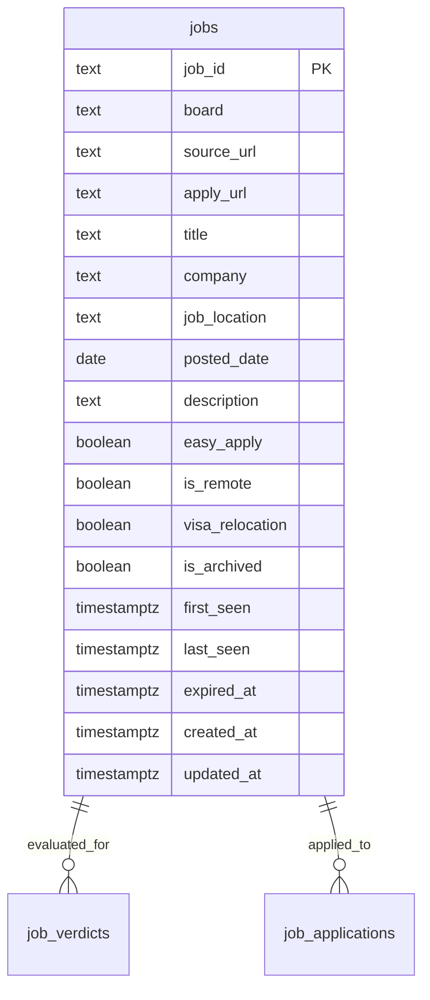

# Jobs Table — Shared Job Listing Pool

## Purpose

`jobs` stores listings discovered by scrapers and other ingestion sources. It is a **globally shared listing pool**: one source listing is stored once and can be evaluated independently for many users.

The table contains facts about a listing, not a user's opinion or workflow. Match results belong in `job_verdicts`; application state belongs in `job_applications`; audit history belongs in `application_activities`.

## Design decisions

| Concern | Decision |
|---|---|
| Ownership | Shared/global; no `user_id` |
| Identity | Stable, namespaced `job_id` |
| Deduplication | One row per source listing |
| User verdicts | `job_verdicts` |
| Application state | `job_applications` |
| Expiration | Archive; do not delete referenced listings |
| Description | Latest usable job description |
| Cross-board deduplication | Out of scope initially |

## Entity relationship



## Table: `jobs`

One row represents one listing from one source board. The same real-world vacancy may appear on multiple boards and therefore have multiple rows. Do not merge listings across boards based only on company/title similarity.

### Columns

| Column | Type | Nullable | Description |
|---|---|---:|---|
| `job_id` | `text` | No | Primary key; stable namespaced source identifier |
| `source_url` | `text` | Yes | URL of the listing on the source board |
| `apply_url` | `text` | Yes | Actual application destination, e.g. ATS URL |
| `board` | `text` | No | Source board/provider, e.g. `linkedin-apify`, `glassdoor-apify` |
| `title` | `text` | No | Job title as listed |
| `company` | `text` | Yes | Company name as listed |
| `job_location` | `text` | Yes | Location text as listed |
| `posted_date` | `date` | Yes | Date the source says the job was posted |
| `description` | `text` | Yes | Latest usable job description |
| `easy_apply` | `boolean` | Yes | Whether the source indicates Easy Apply; `NULL` means unknown |
| `is_remote` | `boolean` | Yes | Whether the role is remote; `NULL` means unknown |
| `visa_relocation` | `boolean` | Yes | Whether visa/relocation support is indicated; `NULL` means unknown |
| `is_archived` | `boolean` | No | Whether the listing is retired from active discovery |
| `archive_reason` | `text` | Yes | `expired`, `duplicate`, `out_of_window`, `removed`, or `other` |
| `first_seen` | `timestamptz` | No | First time this listing was observed |
| `last_seen` | `timestamptz` | No | Most recent successful observation |
| `expired_at` | `timestamptz` | Yes | When the system determined the listing was no longer active |
| `created_at` | `timestamptz` | No | Row creation timestamp |
| `updated_at` | `timestamptz` | No | Last row update timestamp |

### Job identifier format

Use a namespace to avoid collisions between boards:

```text
linkedin-apify:urn:li:jobPosting:123456789
glassdoor-apify:gda123123
```

Preserve the source's stable external ID after the namespace. Do not use the URL as the primary key because URLs can change, redirect, or contain tracking parameters.

## PostgreSQL migration

Assumes `users` and the project's shared `trigger_updated_at()` function already exist. Reuse that function rather than defining a second timestamp trigger implementation.

```sql
CREATE TABLE jobs (
    job_id TEXT PRIMARY KEY,

    source_url TEXT,
    apply_url TEXT,
    board TEXT NOT NULL,

    title TEXT NOT NULL,
    company TEXT,
    job_location TEXT,
    posted_date DATE,
    description TEXT,

    easy_apply BOOLEAN,
    is_remote BOOLEAN,
    visa_relocation BOOLEAN,

    is_archived BOOLEAN NOT NULL DEFAULT FALSE,
    archive_reason TEXT
        CHECK (
            archive_reason IS NULL
            OR archive_reason IN (
                'expired',
                'duplicate',
                'out_of_window',
                'removed',
                'other'
            )
        ),

    first_seen TIMESTAMPTZ NOT NULL DEFAULT NOW(),
    last_seen TIMESTAMPTZ NOT NULL DEFAULT NOW(),
    expired_at TIMESTAMPTZ,

    created_at TIMESTAMPTZ NOT NULL DEFAULT NOW(),
    updated_at TIMESTAMPTZ NOT NULL DEFAULT NOW(),

    CONSTRAINT chk_jobs_seen_range
        CHECK (last_seen >= first_seen),

    CONSTRAINT chk_jobs_archive_reason
        CHECK (
            NOT is_archived
            OR archive_reason IS NOT NULL
            OR expired_at IS NOT NULL
        )
);

CREATE INDEX idx_jobs_board
    ON jobs (board);

CREATE INDEX idx_jobs_first_seen
    ON jobs (first_seen DESC);

CREATE INDEX idx_jobs_last_seen
    ON jobs (last_seen DESC);

CREATE INDEX idx_jobs_active_recent
    ON jobs (last_seen DESC)
    WHERE NOT is_archived;

CREATE TRIGGER trg_jobs_updated_at
    BEFORE UPDATE ON jobs
    FOR EACH ROW EXECUTE FUNCTION trigger_updated_at();
```

### Constraint notes

- `easy_apply`, `is_remote`, and `visa_relocation` are nullable because sources often omit these facts. Do not turn missing data into `false`.
- `last_seen` changes when a listing is observed again. It is distinct from `updated_at`, which changes for any database update.
- An archived row should have an `archive_reason` or `expired_at`.
- If the project intentionally allows archive-without-reason, remove `chk_jobs_archive_reason` and enforce the rule in the service instead.

## Ingestion and upsert behavior

Ingestion must be idempotent. Repeatedly scraping the same source listing updates the existing row.

1. Normalize the board identifier.
2. Extract the source's stable external job ID.
3. Build the namespaced `job_id`.
4. Normalize URLs and dates while preserving the actual source/apply destinations.
5. Upsert the listing.
6. Set `last_seen = NOW()` on each successful observation.
7. Preserve `first_seen` and `created_at`.
8. Do not replace known content with empty or omitted scraper fields.
9. If an archived listing is observed again and confirmed active, reactivate it and clear archive metadata.

Example:

```sql
INSERT INTO jobs (
    job_id, source_url, apply_url, board, title, company,
    job_location, posted_date, description,
    easy_apply, is_remote, visa_relocation
)
VALUES (
    $1, $2, $3, $4, $5, $6, $7, $8, $9, $10, $11, $12
)
ON CONFLICT (job_id) DO UPDATE SET
    source_url = COALESCE(NULLIF(EXCLUDED.source_url, ''), jobs.source_url),
    apply_url = COALESCE(NULLIF(EXCLUDED.apply_url, ''), jobs.apply_url),
    title = EXCLUDED.title,
    company = COALESCE(NULLIF(EXCLUDED.company, ''), jobs.company),
    job_location = COALESCE(NULLIF(EXCLUDED.job_location, ''), jobs.job_location),
    posted_date = COALESCE(EXCLUDED.posted_date, jobs.posted_date),
    description = COALESCE(NULLIF(EXCLUDED.description, ''), jobs.description),
    easy_apply = COALESCE(EXCLUDED.easy_apply, jobs.easy_apply),
    is_remote = COALESCE(EXCLUDED.is_remote, jobs.is_remote),
    visa_relocation = COALESCE(EXCLUDED.visa_relocation, jobs.visa_relocation),
    last_seen = NOW(),
    is_archived = FALSE,
    archive_reason = NULL,
    expired_at = NULL;
```

This example treats `NULL`/empty incoming values as “not provided in this scrape.” If a source explicitly clears a field, represent that as a distinct update operation rather than overloading `NULL`.

## Listing lifecycle

```text
ingested / active
      |
      | source confirms removal, expiry, or listing ages out
      v
   archived
      |
      | observed again and confirmed active
      v
   active
```

- Do not mark a listing expired because one scrape failed. A transient source outage is not proof that the job closed.
- `expired_at` records when the system made the expiration decision; `last_seen` records the last observation.
- If a duplicate is detected, archive the duplicate row and preserve its history. Do not silently rewrite references.

## Retention

Archival is the default retention mechanism.

- Listings older than 60 days by `first_seen` may be archived when they are outside the active discovery window.
- Do not archive solely because `first_seen` is old if the source still returns the listing as active.
- Jobs referenced by `job_verdicts`, `job_applications`, or `application_activities` must remain available for historical views.
- Physical deletion of unreferenced archived rows can be considered later, after retention requirements and all references are inventoried.

Example policy query (tune thresholds to the scrape cadence and source reliability):

```sql
UPDATE jobs
SET
    is_archived = TRUE,
    archive_reason = 'out_of_window',
    expired_at = COALESCE(expired_at, NOW())
WHERE
    is_archived = FALSE
    AND first_seen < NOW() - INTERVAL '60 days'
    AND last_seen < NOW() - INTERVAL '14 days';
```

The 14-day `last_seen` grace period is an example, not a universal rule. Use a longer period for unreliable sources.

## Query patterns

### Active listings by board

```sql
SELECT
    job_id, title, company, job_location,
    posted_date, is_remote, last_seen
FROM jobs
WHERE board = $1
  AND is_archived = FALSE
ORDER BY last_seen DESC
LIMIT $2;
```

### Find a listing

```sql
SELECT *
FROM jobs
WHERE job_id = $1;
```

### Listings with the current user's latest verdict

```sql
SELECT
    j.job_id,
    j.title,
    j.company,
    j.board,
    j.is_remote,
    v.verdict,
    v.decision_summary,
    v.verdicted_at
FROM jobs AS j
LEFT JOIN LATERAL (
    SELECT verdict, decision_summary, verdicted_at
    FROM job_verdicts
    WHERE job_id = j.job_id
      AND user_id = $1
    ORDER BY verdicted_at DESC
    LIMIT 1
) AS v ON TRUE
WHERE j.is_archived = FALSE
ORDER BY j.last_seen DESC;
```

For production pagination, use a stable cursor such as `(last_seen, job_id)` rather than offset pagination over a changing scrape pool.

## Security and tenant isolation

`jobs` is shared listing data, not a user-owned table.

- Public users may read only fields intentionally exposed by the product.
- Only trusted ingestion workers or authorized administrative operations may insert, update, or archive listings.
- A normal user must not be able to alter shared listing facts through API payloads.
- User-specific queries must scope `job_verdicts`, `job_applications`, and `application_activities` by the authenticated internal `users.id`.
- Knowing a public `job_id` does not authorize access to another user's verdict or application.
- Neon does not automatically provide Supabase RLS behavior. Enforce authorization in the Go API and use database constraints as defense in depth.

## What does not belong in `jobs`

| Field / concept | Correct location |
|---|---|
| `user_id` owner | Not applicable; listing pool is shared |
| `matched` / `not_matched` | `job_verdicts` |
| Match percentage | `job_verdicts` |
| AI summary, evidence, concerns | `job_verdicts` |
| User approval / rejection | User review/application workflow |
| `draft`, `applying`, `applied`, `failed`, `submitted_unknown`, `skipped` | `job_applications` |
| Cover-letter text/version | `cover_notes` |
| Application event history | `application_activities` |
| Raw LLM chain-of-thought | Do not store on `jobs` |

## Out of scope

- A normalized `companies` table.
- A canonical cross-board entity that merges multiple source listings.
- Full scrape-attempt history and source health telemetry.
- A global taxonomy for employment type, seniority, and workplace type.
- Full-text search indexes and ranking strategy; add after query patterns are measured.
- Source-specific raw payload retention; add a JSONB field or ingestion table only when a concrete reprocessing/debugging need exists.
