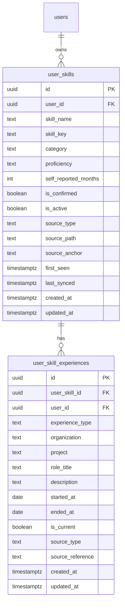

# User Skills and Skill Experience Data Model

## Purpose

The career profile needs to represent two related but distinct concepts:

1. **Skill inventory** — the skills a user says they know, including self-assessed proficiency.
2. **Skill experience** — the roles, projects, and other contexts in which the user used or learned each skill.

A user can have multiple experience records for one skill. For example, Go can be linked to work at multiple employers and to personal projects.

## Design decisions

| Concern | Decision |
|---|---|
| Skill inventory | One row per user and normalized skill |
| Experience evidence | Separate table; multiple records per skill |
| Proficiency | Self-assessed |
| Experience duration | Calculated from dated evidence as the primary value |
| Manual duration | Retained as a user-reported value for comparison |
| Date precision | Experience dates may be unknown; unknown dates are nullable |
| Deletion | Soft-deactivate skills; preserve historical evidence |
| Tenant isolation | Internal user UUID and composite foreign keys |
| Global skill catalog | Not included in this initial design |

## Entity relationship



`users.id` is the application's internal UUID. The authentication provider's identifier belongs in `users.clerk_user_id`; it is not used as the foreign key in these tables.

## Table: `user_skills`

One row represents one skill in a user's inventory.

### Columns

| Column | Type | Nullable | Description |
|---|---|---:|---|
| `id` | `uuid` | No | Primary key |
| `user_id` | `uuid` | No | Owner; references `users(id)` |
| `skill_name` | `text` | No | Display name, e.g. `Golang` |
| `skill_key` | `text` | No | Normalized key used for uniqueness, e.g. `go` |
| `category` | `text` | Yes | Skill category such as `language`, `framework`, `database`, `cloud`, `devops`, `concept`, or `tool` |
| `proficiency` | `text` | Yes | Self-assessed level: `beginner`, `intermediate`, `advanced`, or `expert` |
| `self_reported_months` | `integer` | Yes | User-entered estimate of months of experience |
| `is_confirmed` | `boolean` | No | Whether the user has reviewed and confirmed this skill |
| `is_active` | `boolean` | No | Whether this skill is currently part of the user's active profile |
| `source_type` | `text` | No | Origin: `profile`, `manual`, or `imported` |
| `source_path` | `text` | Yes | Source document/profile path when applicable |
| `source_anchor` | `text` | Yes | Optional heading, section, or anchor within the source |
| `first_seen` | `timestamptz` | Yes | When the skill was first observed |
| `last_synced` | `timestamptz` | Yes | Last successful synchronization from its source |
| `created_at` | `timestamptz` | No | Creation timestamp |
| `updated_at` | `timestamptz` | No | Last update timestamp |

### Constraints

- Primary key: `id`.
- Unique: `(user_id, skill_key)`.
- Composite unique key: `(id, user_id)`, so child records can enforce ownership with a composite foreign key.
- `self_reported_months` must be non-negative when present.
- `proficiency` and `source_type` should be constrained to the documented values.
- `is_confirmed` and `is_active` default to `false` and `true`, respectively.

## Table: `user_skill_experiences`

One row represents one evidence record for a skill. A skill may have zero or many evidence records.

### Columns

| Column | Type | Nullable | Description |
|---|---|---:|---|
| `id` | `uuid` | No | Primary key |
| `user_skill_id` | `uuid` | No | Related skill |
| `user_id` | `uuid` | No | Owner; repeated to enforce tenant consistency |
| `experience_type` | `text` | No | `professional`, `freelance`, `personal`, `learning`, `open_source`, or `education` |
| `organization` | `text` | Yes | Employer or organization |
| `project` | `text` | Yes | Project name |
| `role_title` | `text` | Yes | Role held while using the skill |
| `description` | `text` | Yes | How the skill was used |
| `started_at` | `date` | Yes | Start date, if known |
| `ended_at` | `date` | Yes | End date, if known |
| `is_current` | `boolean` | No | Whether this experience is ongoing |
| `source_type` | `text` | No | Origin: `profile`, `manual`, or `imported` |
| `source_reference` | `text` | Yes | Reference to the source record/document |
| `created_at` | `timestamptz` | No | Creation timestamp |
| `updated_at` | `timestamptz` | No | Last update timestamp |

### Constraints

- Primary key: `id`.
- Composite foreign key `(user_skill_id, user_id)` references `user_skills(id, user_id)`.
- `ended_at` cannot be earlier than `started_at` when both are present.
- A current experience cannot have an `ended_at` value.
- Dates are nullable so users can record evidence even when exact dates are unknown. Records without usable dates do not contribute to calculated duration.

## PostgreSQL migration

This migration assumes the `users` table already exists with `id uuid` and that the project already has a shared `trigger_updated_at()` function. If the existing migration uses a different trigger function name, use that established function consistently rather than creating a duplicate.

```sql
CREATE TABLE user_skills (
    id UUID PRIMARY KEY DEFAULT gen_random_uuid(),
    user_id UUID NOT NULL REFERENCES users(id) ON DELETE RESTRICT,

    skill_name TEXT NOT NULL,
    skill_key TEXT NOT NULL,
    category TEXT,

    proficiency TEXT
        CHECK (proficiency IN ('beginner', 'intermediate', 'advanced', 'expert')),
    self_reported_months INTEGER
        CHECK (self_reported_months IS NULL OR self_reported_months >= 0),

    is_confirmed BOOLEAN NOT NULL DEFAULT FALSE,
    is_active BOOLEAN NOT NULL DEFAULT TRUE,

    source_type TEXT NOT NULL
        CHECK (source_type IN ('profile', 'manual', 'imported')),
    source_path TEXT,
    source_anchor TEXT,

    first_seen TIMESTAMPTZ,
    last_synced TIMESTAMPTZ,

    created_at TIMESTAMPTZ NOT NULL DEFAULT NOW(),
    updated_at TIMESTAMPTZ NOT NULL DEFAULT NOW(),

    CONSTRAINT uq_user_skills_user_skill_key UNIQUE (user_id, skill_key),
    CONSTRAINT uq_user_skills_id_user UNIQUE (id, user_id)
);

CREATE INDEX idx_user_skills_user_active
    ON user_skills (user_id, is_active);

CREATE TABLE user_skill_experiences (
    id UUID PRIMARY KEY DEFAULT gen_random_uuid(),
    user_skill_id UUID NOT NULL,
    user_id UUID NOT NULL,

    experience_type TEXT NOT NULL
        CHECK (experience_type IN (
            'professional',
            'freelance',
            'personal',
            'learning',
            'open_source',
            'education'
        )),

    organization TEXT,
    project TEXT,
    role_title TEXT,
    description TEXT,

    started_at DATE,
    ended_at DATE,
    is_current BOOLEAN NOT NULL DEFAULT FALSE,

    source_type TEXT NOT NULL
        CHECK (source_type IN ('profile', 'manual', 'imported')),
    source_reference TEXT,

    created_at TIMESTAMPTZ NOT NULL DEFAULT NOW(),
    updated_at TIMESTAMPTZ NOT NULL DEFAULT NOW(),

    CONSTRAINT fk_user_skill_experiences_skill_owner
        FOREIGN KEY (user_skill_id, user_id)
        REFERENCES user_skills (id, user_id)
        ON DELETE RESTRICT,

    CONSTRAINT chk_user_skill_experiences_date_range
        CHECK (
            started_at IS NULL
            OR ended_at IS NULL
            OR ended_at >= started_at
        ),

    CONSTRAINT chk_user_skill_experiences_current_end
        CHECK (NOT is_current OR ended_at IS NULL)
);

CREATE INDEX idx_user_skill_experiences_skill
    ON user_skill_experiences (user_skill_id);

CREATE INDEX idx_user_skill_experiences_user
    ON user_skill_experiences (user_id);

-- Reuse the project's existing updated_at trigger function.
CREATE TRIGGER trg_user_skills_updated_at
    BEFORE UPDATE ON user_skills
    FOR EACH ROW EXECUTE FUNCTION trigger_updated_at();

CREATE TRIGGER trg_user_skill_experiences_updated_at
    BEFORE UPDATE ON user_skill_experiences
    FOR EACH ROW EXECUTE FUNCTION trigger_updated_at();
```

If `gen_random_uuid()` is not available in the target PostgreSQL setup, enable the appropriate UUID-generation support or generate UUIDs in the application. Confirm the existing migration conventions before applying this SQL.

## Calculating experience duration

Do not persist a calculated duration as the authoritative value. It can become stale when an experience is edited, ended, or corrected.

Calculate duration from the union of dated intervals:

1. Select the skill's experience records with a known `started_at`.
2. For ongoing records, use the current date as the effective end date.
3. For closed records, use `ended_at`.
4. Ignore records whose dates are insufficient to form a valid interval.
5. Merge overlapping or adjacent intervals before summing. This prevents counting the same calendar period twice when two projects overlap.
6. Return the result in months (or a consistent day-based calculation converted for display).

Keep separate totals where useful:
- **Professional duration:** union of `professional` and `freelance` intervals.
- **All-context duration:** union of all experience types.

`self_reported_months` is a separate user-provided estimate. Display it as self-reported and do not silently combine it with the calculated value.

## Tenant isolation and application behavior

- Every query must be scoped by the authenticated user's internal `users.id`.
- Resolve the Clerk identity to the internal user record before accessing career-profile data.
- Repository methods should require `userID` explicitly; avoid unscoped methods such as `GetSkill(id)` for user-owned records.
- The composite foreign key on experiences prevents a skill owned by one user from being linked to an experience row claiming another user.
- Neon does not automatically provide Supabase RLS behavior. Enforce tenant authorization in the Go API and use database constraints as defense in depth.

## Profile synchronization rules

Profile synchronization must not overwrite user-maintained data.

- A newly discovered skill can be inserted with `source_type = 'profile'`.
- A profile-sourced skill that disappears from the source can be marked inactive; do not hard-delete it.
- A manually maintained skill must not be deactivated merely because it is absent from the imported profile.
- Do not overwrite manually edited proficiency or `self_reported_months` with imported values.
- Profile-sourced experience records may be updated from their source; manual records must remain user-controlled.
- If a skill is renamed, preserve the old record and its evidence, deactivate it when appropriate, and create or reconcile the new normalized skill key. Do not silently reassign historical evidence to a different skill.

Use stable source identifiers for imported evidence so repeated syncs are idempotent.

## Example

A user has one `Go` skill with two evidence records:

| Type | Organization / project | Dates |
|---|---|---|
| Professional | Company A — Wallet service | Jan 2021 – Jan 2023 |
| Professional | Company B — Transaction platform | Apr 2023 – Present |

The calculated professional duration is the union of those date ranges. If the intervals overlap, the overlapping time is counted once. A separate personal project can be added as another experience record without creating a duplicate `Go` skill.

## Out of scope for this version

- A global canonical skills catalog and alias mapping.
- Peer-verified or employer-verified proficiency.
- AI-generated proficiency scoring.
- Persisted calculated-duration snapshots.
- Skill-gap records. If the product needs to track missing skills against a target role, model that separately from the user's known skills and experience evidence.
