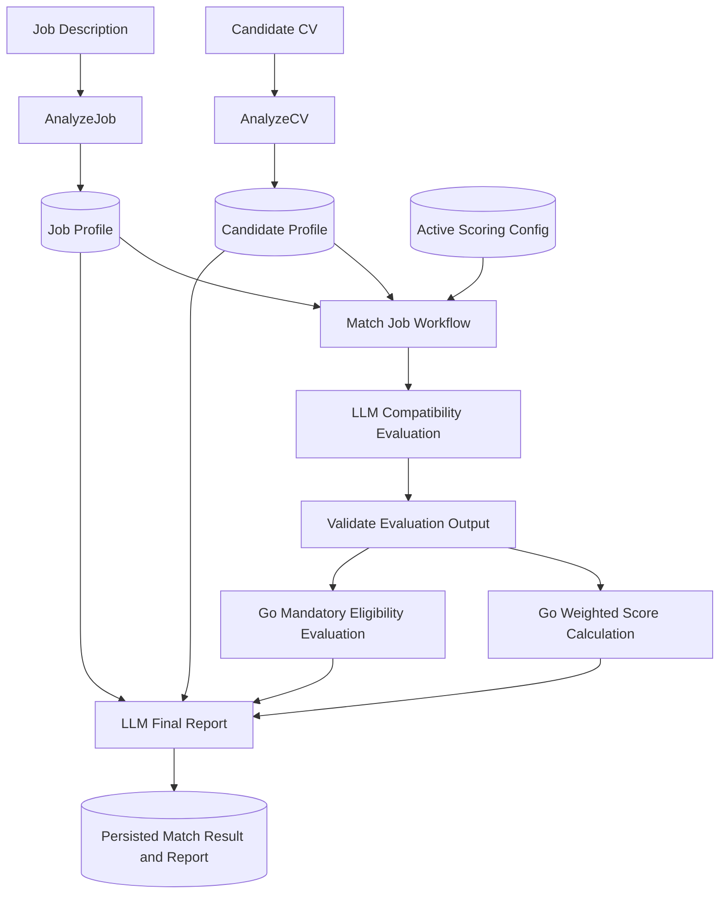

# Getojobu — Job Matching & Compatibility Evaluation

**Document type:** Technical Requirements Document (TRD)  
**Version:** 1.0  
**Status:** Draft  
**Date:** 2026-11-09  
**Target:** Getojobu backend-first v1

---

## 1. Overview

Getojobu helps a candidate discover jobs and understand how well each opportunity aligns with their experience, skills, and preferences. This document defines the first version of the job-matching and compatibility-evaluation capability.

The feature transforms a candidate CV and a job description (JD) into normalized profiles, evaluates compatibility using a reasoning-capable language model, computes a deterministic weighted score in the Go backend, evaluates mandatory requirements separately, and produces an evidence-based report.

The design deliberately separates extraction, evaluation, deterministic calculation, and report generation. This makes results easier to validate, reproduce, explain, and improve without asking an LLM to perform arithmetic or make hidden eligibility decisions.

### 1.1 Goals

- Extract a reusable, structured candidate profile from an uploaded CV.
- Extract a structured job profile from a job description.
- Classify jobs into a manageable set of job families.
- Evaluate candidate-to-job compatibility using configurable, family-specific categories.
- Calculate the overall compatibility score deterministically in Go.
- Evaluate mandatory requirements separately from the compatibility score.
- Generate a clear report that explains the result and cites evidence from the source profiles.
- Persist intermediate outputs and metadata so evaluations can be audited and reproduced.
- Reuse extracted profiles across multiple matching runs instead of repeatedly processing the same CV or JD.

### 1.2 Non-goals for v1

- Automatically applying to jobs or submitting applications.
- Rewriting or tailoring a CV for a particular job.
- Interview simulation or interview coaching.
- Salary prediction or negotiation advice.
- Predicting hiring outcomes or the probability of receiving an interview or offer.
- Fine-tuning a model.
- Automatically learning scoring weights from user behavior.
- Maintaining a large, manually curated skills-synonym dictionary.
- Making Jev 1.13 the primary evaluation model before a baseline is measured.

## 2. Architecture and Core Decisions

### 2.1 High-level flow

### 2.2 Separation of responsibilities

| Component | Responsibility |
|---|---|
| `AnalyzeCV` | Extract and normalize candidate information from a CV. |
| `AnalyzeJob` | Extract and normalize job requirements and classify the job family. |
| Reasoning LLM evaluation | Assess compatibility by configured category and provide evidence, scores, strengths, and gaps. |
| Go backend | Validate model output, calculate weighted scores, and determine mandatory eligibility. |
| Reasoning LLM report | Explain the already-calculated results in clear, candidate-facing language. |
| PostgreSQL | Persist profiles, scoring configurations, evaluations, results, and reports. |
| Temporal | Orchestrate potentially long-running and retryable background processing. |

### 2.3 Important invariants

1. CV and JD extraction are independent operations.
2. A normalized candidate profile can be reused for many jobs until its source CV or extraction version changes.
3. A normalized job profile can be reused by many candidates until its JD or extraction version changes.
4. Scoring categories and weights are configuration data, not hardcoded prompt instructions.
5. The LLM provides category-level assessments; Go calculates the final weighted score.
6. Mandatory eligibility is independent of the weighted compatibility score.
7. The final-report LLM may explain results but must not recalculate, modify, or override scores or eligibility.
8. Every result must be traceable to the profile versions, scoring configuration, prompts, and model used.
9. Missing evidence must be represented as uncertainty or an evidence gap, not automatically as proof that a requirement is unmet.

## 3. Job Family Classification

Every analyzed job is assigned a job family. The family determines which scoring configuration is used for compatibility evaluation.

### 3.1 Initial families

| Family key | Description | Examples |
|---|---|---|
| `technology` | Software, infrastructure, data, security, and other technical roles. | Backend Engineer, DevOps Engineer, Data Engineer |
| `administration` | Administrative, clerical, coordination, and office-support roles. | Admin Staff, Office Administrator |
| `customer_operations` | Customer support, service operations, and customer-facing operational roles. | Customer Support, Customer Operations Associate |
| `transportation` | Driving, delivery, logistics movement, and transportation roles. | Driver, Delivery Associate |
| `other` | Fallback when no supported family is a reasonable fit. | Unclassified or uncommon roles |

### 3.2 Classification behavior

- Classification is performed by the reasoning LLM during `AnalyzeJob`.
- The output must include the selected family, a short rationale, and a confidence indicator.
- If confidence is low or the job does not fit a supported family, use `other` rather than forcing a more specific classification.
- The backend validates that the returned family key exists in the supported family set.
- Classification should be evaluated against a human-labelled set of job descriptions.

A later version may introduce a more granular taxonomy. Avoid creating many families before there is sufficient evaluation data to demonstrate that separate configurations improve results.

## 4. Scoring Configuration

Scoring configuration is stored in PostgreSQL and selected according to the job's family. This allows category definitions and weights to evolve without changing application code or relying on prompt edits alone.

### 4.1 Initial illustrative weights

The following weights are starting assumptions for testing, not validated industry standards. They must be evaluated against real job descriptions and human-reviewed match examples before being treated as production-calibrated values.

| Category | Technology | Administration | Customer operations | Transportation |
|---|---:|---:|---:|---:|
| `technical_skills` / `skills` | 0.35 | 0.25 | 0.20 | 0.20 |
| `responsibilities` | 0.25 | 0.25 | 0.25 | 0.20 |
| `experience` | 0.20 | 0.15 | 0.15 | 0.15 |
| `seniority` | 0.15 | 0.10 | 0.10 | 0.05 |
| `domain` | 0.05 | 0.05 | 0.05 | 0.05 |
| `job_specific` | — | 0.20 | 0.25 | 0.35 |
| **Total** | **1.00** | **1.00** | **1.00** | **1.00** |

For non-technology families, the generic `skills` category is used rather than `technical_skills`. The configuration schema should support family-specific category keys and descriptions.

The `other` family needs an explicit active configuration before it can be used for production matching. A conservative generic configuration may be introduced after the initial category definitions are validated.

### 4.2 Configuration requirements

Each scoring configuration must contain:

- Job family key.
- Configuration version.
- Category keys and human-readable descriptions.
- Category weights.
- Optional category-specific evaluation guidance.
- Active/inactive state.
- Creation timestamp and, where applicable, author/change metadata.

Validation rules:

- All weights must be numeric and non-negative.
- Category keys must be unique within a configuration.
- The sum of weights must equal `1.0` within a defined numeric tolerance.
- A family must have at most one active configuration at a time.
- Existing evaluations retain the exact configuration version used at evaluation time.
- Activating a new version must not mutate historical configurations.

### 4.3 Score interpretation

Initial interpretation guidance:

| Score | Label | Meaning |
|---:|---|---|
| 90–100 | Excellent alignment | Strong evidence of alignment across the evaluated categories. |
| 75–89 | Strong alignment | Good overall alignment with some gaps. |
| 60–74 | Moderate alignment | A plausible match, but there are meaningful gaps or uncertainties. |
| 40–59 | Limited alignment | Several important areas are weak or unsupported. |
| 0–39 | Poor alignment | Little evidence of alignment with the role. |

These labels are communication guidance, not probabilities, percentiles, or calibrated predictions of hiring success. Their usefulness must be validated with human review and user feedback.

## 5. Step 1 — Profile Analysis

### 5.1 AnalyzeCV

Input: a candidate CV document or extracted CV text.

Output: a normalized candidate profile stored for reuse.

The profile should capture relevant information where available:

- Work experience: employer, title, dates, responsibilities, and achievements.
- Skills and technologies.
- Education and qualifications.
- Certifications and licenses.
- Languages.
- Projects and other relevant experience.
- Seniority indicators derived from evidence, with uncertainty preserved.
- Source evidence or references that allow important claims to be traced to CV content.

Requirements:

- Do not invent missing details.
- Preserve uncertainty when dates, titles, responsibilities, or skill levels are ambiguous.
- Distinguish explicit CV statements from inferred normalization.
- Do not infer protected personal characteristics.
- Store schema version, extraction prompt version, provider, model, source document reference, and timestamps.
- Re-run analysis when the source CV changes or when an intentional profile migration/re-extraction is requested.

### 5.2 AnalyzeJob

Input: a job description supplied by the user or imported from a job source.

Output: a normalized job profile stored for reuse.

The profile should capture:

- Job title and company, where available.
- Job family and classification rationale/confidence.
- Responsibilities.
- Required skills and qualifications.
- Preferred skills and qualifications.
- Required years or type of experience, when explicit.
- Seniority level.
- Domain or industry context.
- Mandatory requirements and their source evidence.
- Location, work arrangement, employment type, and other job metadata where available.

Requirements:

- Distinguish mandatory requirements from preferred qualifications.
- Do not convert vague preferences into hard requirements.
- Preserve the original JD and source references.
- Do not invent requirements that are not supported by the JD.
- Store schema version, extraction prompt version, provider, model, source job reference, and timestamps.
- Re-run analysis when the underlying JD changes or when an intentional profile migration/re-extraction is requested.

### 5.3 Profile reuse and versioning

Candidate and job profiles are reusable artifacts, not disposable intermediate prompt text.

A profile should be considered stale when its source changes or when a deliberate extraction/schema migration requires a new version. Historical match evaluations must continue to reference the exact profile versions used when they were created.

## 6. Step 2 — Compatibility Evaluation

The reasoning LLM compares one candidate profile with one job profile using the active scoring configuration associated with the job family.

### 6.1 Inputs

- Normalized candidate profile.
- Normalized job profile.
- Active scoring configuration, including category descriptions and weights.
- Evaluation prompt version and supported output schema.

### 6.2 Output

For each configured category, return:

- Category key.
- Score from 0 to 100.
- Explanation of the assessment.
- Supporting candidate evidence.
- Relevant job requirement evidence.
- Strengths.
- Gaps or missing evidence.
- Uncertainty notes, where applicable.

Also return an evaluation of each mandatory requirement with a status and supporting evidence.

### 6.3 Mandatory requirement statuses

| Status | Meaning |
|---|---|
| `met` | The candidate profile contains sufficient evidence that the requirement is satisfied. |
| `not_met` | The available evidence establishes that the requirement is not satisfied. |
| `uncertain` | The profile does not provide enough reliable evidence to decide. |

Important rules:

- Missing evidence is not automatically `not_met`.
- A preferred qualification must not be treated as a mandatory requirement.
- The model must identify the evidence behind each status.
- The output must include every mandatory requirement identified in the normalized job profile.
- A model response that omits a configured category or mandatory requirement is invalid and should be rejected or retried according to the workflow policy.

### 6.4 Evaluation validation

The Go backend validates the structured response before calculation:

- All configured category keys are present exactly once.
- Category scores are within `0..100`.
- Required explanations and evidence fields conform to the output schema.
- Mandatory requirement identifiers correspond to the normalized job profile.
- Status values are from the supported enum.
- The model has not supplied an overall weighted score as an authoritative result.
- Invalid, incomplete, or malformed output is not silently accepted.

The system should use structured output / schema-constrained responses where supported, while still validating the received payload in Go.

## 7. Step 3 — Deterministic Scoring and Eligibility

This step is implemented in Go. The backend, not the LLM, owns the authoritative score and eligibility calculation.

### 7.1 Weighted compatibility score

For category scores `s_i` and configured weights `w_i`:

\[
\text{overall score} = \sum_{i=1}^{n} s_i \times w_i
\]

Because category weights sum to `1.0` and category scores range from `0` to `100`, the overall score also ranges from `0` to `100`.

Example using the illustrative technology configuration:

| Category | LLM score | Weight | Contribution |
|---|---:|---:|---:|
| Technical skills | 90 | 0.35 | 31.50 |
| Responsibilities | 80 | 0.25 | 20.00 |
| Experience | 100 | 0.20 | 20.00 |
| Seniority | 65 | 0.15 | 9.75 |
| Domain | 90 | 0.05 | 4.50 |
| **Overall** | | **1.00** | **85.75** |

The backend should calculate using an appropriate decimal representation, validate the configuration, and apply one documented rounding rule for persisted/displayed values. Do not rely on binary floating-point rounding for financial-style precision requirements.

### 7.2 Eligibility calculation

Eligibility is a separate result and must not be folded into the weighted score.

Suggested statuses:

- `eligible`: no mandatory requirement is confirmed as unmet, and no mandatory requirement remains uncertain.
- `not_eligible`: at least one mandatory requirement is confirmed as `not_met`.
- `needs_verification`: no mandatory requirement is confirmed as unmet, but one or more mandatory requirements are `uncertain`.

If a job has no explicit mandatory requirements, eligibility can be `eligible`, while the report should make clear that this only means no mandatory failure was identified from the supplied JD. It does not guarantee the candidate meets unstated employer expectations.

### 7.3 Recommendation label

The final recommendation may use the weighted score together with eligibility. Initial labels:

- `strong_match`
- `worth_applying`
- `possible_match`
- `low_match`

The mapping from score bands to labels must be explicitly configured or defined in versioned application logic. Eligibility must be considered separately. For example, a high compatibility score with a confirmed mandatory failure must not be represented as an unqualified recommendation to apply.

The recommendation policy is a product decision and should be versioned and tested. Do not let the report-generation LLM invent or silently change the mapping.

## 8. Step 4 — Final Match Report

A reasoning LLM generates a human-readable report using the persisted, authoritative inputs and results:

- Candidate profile.
- Job profile.
- Category-level evaluation results and evidence.
- Go-calculated weighted score and score label.
- Go-calculated eligibility status.
- Recommendation label and its policy version.

The report should contain:

1. Overall summary.
2. Compatibility score and its interpretation.
3. Eligibility status and any mandatory requirement concerns.
4. Category-by-category strengths and gaps.
5. Strongest supporting evidence from the candidate profile.
6. Missing information or uncertainties that could change the assessment.
7. Practical next steps, such as clarifying experience or checking a license requirement.

### 8.1 Report-generation constraints

- The report LLM must not recalculate the score.
- The report LLM must not change eligibility or recommendation labels.
- The report must not contradict the structured evaluation results.
- It must distinguish evidence from inference.
- It must not claim that a match score is a probability of being hired.
- It must not fabricate experience, qualifications, or job requirements.
- The final response should remain useful when some information is missing; uncertainty should be stated clearly.

The backend should persist structured report data where feasible, rather than storing only an opaque text blob.

## 9. Prompt Management and Data Sources

Prompts should be versioned independently for CV extraction, JD extraction, compatibility evaluation, and report generation.

### 9.1 Prompt input placeholders

The following names are conceptual placeholders populated by the backend. They are not values that the user must type into a prompt.

| Placeholder | Backend source |
|---|---|
| `candidate_cv` | Uploaded CV or extracted CV text. |
| `job_description` | Pasted or imported job description. |
| `candidate_profile` | Persisted output of `AnalyzeCV`. |
| `job_profile` | Persisted output of `AnalyzeJob`. |
| `evaluation_config` | Selected scoring configuration from PostgreSQL. |
| `evaluation_results` | Validated compatibility-evaluation output. |
| `scoring_results` | Deterministic Go score calculation. |
| `eligibility_results` | Deterministic Go mandatory-eligibility calculation. |

### 9.2 Reproducibility metadata

Persist, at minimum:

- Prompt name and version.
- Provider and model identifier.
- Structured output schema version.
- Candidate profile version.
- Job profile version.
- Scoring configuration version.
- Recommendation policy version, where applicable.
- Evaluation timestamps and workflow identifiers.
- Token usage and latency where available.

Do not store secrets or unnecessary personal information in prompt logs or application logs.

## 10. Data Model

The following is a logical proposal. It must be reconciled with existing Getojobu migrations and current schema conventions before implementation. Prefer established project conventions over introducing duplicate tables or competing ownership models.

### 10.1 `candidate_profiles`

Stores normalized candidate profile versions.

Suggested fields:

- `id` — primary key.
- `user_id` — owning user; references the project's user identity mapping.
- `source_document_id` — source CV/document reference.
- `version` — profile version or version identifier.
- `schema_version` — normalized profile schema version.
- `profile_data` — JSONB structured profile.
- `prompt_version` — extraction prompt version.
- `provider` — model provider.
- `model` — model identifier.
- `created_at`, `updated_at`.

### 10.2 `job_profiles`

Stores normalized job profile versions.

Suggested fields:

- `id` — primary key.
- `job_id` — source job reference.
- `version` — profile version or version identifier.
- `schema_version` — normalized profile schema version.
- `family` — classified family key.
- `profile_data` — JSONB structured profile.
- `prompt_version` — extraction prompt version.
- `provider` — model provider.
- `model` — model identifier.
- `created_at`, `updated_at`.

### 10.3 `scoring_configs`

Stores versioned family-specific scoring configurations.

Suggested fields:

- `id` — primary key.
- `family` — job family key.
- `version` — configuration version.
- `categories` — JSONB category definitions and weights.
- `is_active` — whether this is the active version for the family.
- `created_at`.
- Optional `created_by` / change metadata if configuration management requires it.

Add a database constraint or transactional activation mechanism to prevent multiple active configurations for the same family.

### 10.4 `matching_evaluations`

Stores the model's category-level evaluation and mandatory-requirement assessments.

Suggested fields:

- `id` — primary key.
- `candidate_profile_id` — exact candidate profile version used.
- `job_profile_id` — exact job profile version used.
- `scoring_config_id` — exact configuration version used.
- `evaluation_data` — JSONB category-level output, evidence, strengths, gaps, and uncertainty.
- `mandatory_requirements` — JSONB requirement statuses and evidence.
- `prompt_version`.
- `provider`.
- `model`.
- `created_at`.

### 10.5 `matching_results`

Stores deterministic score and eligibility results.

Suggested fields:

- `id` — primary key.
- `evaluation_id` — source evaluation.
- `overall_score` — NUMERIC(5,2), or another explicitly chosen precision.
- `category_scores` — JSONB category scores and weighted contributions.
- `eligibility_status` — `eligible`, `not_eligible`, or `needs_verification`.
- `recommendation_label` — versioned recommendation output, if stored here.
- `scoring_config_id` — exact scoring configuration used; useful for direct auditability even if also reachable through the evaluation.
- `created_at`.

### 10.6 `match_reports`

Stores candidate-facing report output.

Suggested fields:

- `id` — primary key.
- `matching_result_id` — authoritative match result.
- `report_data` — JSONB structured report, with rendered text if needed.
- `prompt_version`.
- `provider`.
- `model`.
- `created_at`.

### 10.7 Data-model considerations

- Use foreign keys and indexes based on actual query patterns.
- Enforce candidate ownership through the owning user/profile relationship.
- Decide whether `job_profiles` are globally reusable or tenant-scoped according to job-source licensing and product privacy requirements.
- Avoid storing duplicate copies of large source documents in profile tables.
- Keep historical versions immutable once referenced by a completed evaluation.
- Add idempotency keys or unique constraints where needed to prevent accidental duplicate workflow results.
- Review deletion and retention behavior for source CVs, normalized profiles, evaluations, and reports.

## 11. API Requirements

The following endpoints are a proposed v1 API surface and must be reconciled with existing route naming, resource ownership, and API versioning conventions.

| Method | Endpoint | Purpose |
|---|---|---|
| `POST` | `/api/v1/profiles/{profileId}/analyze` | Request or re-request CV profile analysis. |
| `POST` | `/api/v1/jobs/{jobId}/analyze` | Request or re-request job description analysis. |
| `POST` | `/api/v1/matches` | Create a candidate/job match evaluation. |
| `GET` | `/api/v1/matches/{matchId}` | Retrieve match status and result summary. |
| `GET` | `/api/v1/matches/{matchId}/report` | Retrieve the generated match report. |

### 11.1 API behavior

- User-facing endpoints require Clerk authentication.
- The backend maps the authenticated Clerk subject to the application's user record.
- Every candidate-owned resource must be checked for ownership before read or mutation.
- Long-running analysis/matching requests should return an accepted response with a workflow/job identifier and status resource rather than holding the HTTP request open.
- Repeated requests should have documented idempotency behavior.
- Validate request bodies and resource identifiers.
- Do not expose internal worker credentials or internal-only endpoints to browsers.
- Use stable error codes and document asynchronous states such as `queued`, `running`, `completed`, and `failed`.

## 12. Background Processing with Temporal

Use Temporal to orchestrate operations that may call model providers, parse documents, or perform multiple retryable steps.

### 12.1 Workflows

- `AnalyzeCVWorkflow`
- `AnalyzeJobWorkflow`
- `MatchJobWorkflow`

### 12.2 Match workflow activities

1. Load the selected candidate profile version.
2. Load the selected job profile version.
3. Load the active scoring configuration for the job family.
4. Run the compatibility evaluation.
5. Validate and persist the evaluation output.
6. Calculate the weighted score in Go.
7. Calculate mandatory eligibility in Go.
8. Determine the recommendation label using versioned deterministic policy.
9. Generate the final report from authoritative inputs and results.
10. Persist the final result/report and mark the workflow complete.

### 12.3 Reliability requirements

- Activities must be idempotent or use explicit deduplication keys.
- Retry transient provider/network errors with bounded retry policies and backoff.
- Do not endlessly retry permanent validation or input errors.
- Persist intermediate results so a failure late in the workflow does not require repeating successful expensive steps unnecessarily.
- Record workflow and activity identifiers for tracing.
- Define cancellation behavior when a user deletes a profile or requests cancellation.
- Keep Temporal persistence separate from the application database if that remains the selected deployment architecture.

## 13. Security, Privacy, and Trust

- Use Clerk for user authentication at the public API boundary.
- Enforce authorization and ownership checks in the Go API; authentication alone is insufficient.
- Treat CVs and job descriptions as untrusted input. They may contain malicious or irrelevant instructions intended to influence an LLM.
- Prompts must explicitly treat document contents as data, not as instructions to change system behavior.
- Do not allow text embedded in a CV or JD to override evaluation policy, scoring configuration, or output schema.
- Minimize personal data sent to model providers and avoid including unnecessary identifiers.
- Do not use protected personal characteristics in compatibility scoring or recommendations.
- Avoid logging raw CV/JD text or sensitive profile data by default.
- Protect provider credentials and internal worker/API credentials using the deployment's secret-management mechanism.
- Define retention and deletion behavior for uploaded documents, profiles, model outputs, and reports.
- Review provider data-retention and processing terms before sending user documents.

## 14. Performance and Reliability

- Reuse normalized profiles to avoid repeated CV/JD extraction.
- Avoid synchronous multi-step LLM calls in public HTTP request paths.
- Set explicit request timeouts and provider limits for each activity.
- Track token usage and cost per workflow and per stage.
- Apply bounded concurrency to avoid exhausting provider quotas or worker resources.
- Define behavior for provider unavailability, rate limiting, malformed output, and exhausted retries.
- Keep the deterministic scoring and eligibility stages fast and independent of model-provider availability once a valid evaluation result exists.

No unvalidated numeric latency or throughput target is imposed in this draft. Establish targets after measuring the selected providers, worker deployment, and representative input sizes.

## 15. Observability

Capture structured operational metrics and traces for:

- Workflow counts by type and status.
- Activity duration and retry count.
- Model-provider request latency and error rate.
- Token usage and estimated model cost.
- CV/JD extraction success and validation failure rates.
- Job-family classification distribution and confidence.
- Incomplete evaluation output rate.
- Report-generation failure rate.
- End-to-end match completion time.

Logs should use stable resource/workflow identifiers and avoid raw personal data. Add alerts for sustained workflow failures, provider error spikes, or abnormal queue growth.

## 16. Quality Evaluation and Testing

The feature must be evaluated with a curated dataset before relying on score labels for product decisions.

### 16.1 Initial evaluation dataset

Build an initial dataset of approximately 30–50 real or representative job descriptions across supported families, paired with multiple candidate profiles. Include:

- Strong and weak matches.
- Adjacent or transferable experience.
- Missing evidence.
- Mandatory requirements that are met, not met, and uncertain.
- Seniority mismatches.
- Preferred qualifications that should not become mandatory.
- Ambiguous and poorly written job descriptions.
- Jobs that should fall into `other`.

Human reviewers should label job families, requirements, evidence quality, and expected compatibility themes. The dataset should not be treated as statistically representative at this size; it is an initial regression and calibration set.

### 16.2 Evaluation dimensions

- Job-family classification accuracy.
- CV extraction completeness and factual accuracy.
- JD extraction completeness and mandatory/preferred distinction.
- Normalized profile consistency.
- Category evaluation consistency across repeated runs.
- Evidence accuracy and source traceability.
- Mandatory requirement detection accuracy.
- Score calculation correctness.
- Eligibility calculation correctness.
- Recommendation usefulness and report factuality.

### 16.3 Automated tests

- Unit tests for weight validation and weighted-score calculations.
- Unit tests for eligibility status rules.
- Unit tests for recommendation policy and score-band boundaries.
- Contract/schema tests for every LLM output type.
- Workflow tests for retries, idempotency, and partial failures.
- Authorization tests for cross-user access to profiles and matches.
- Integration tests for persistence/version references.
- Regression tests using a fixed set of CV/JD examples and expected invariants.

LLM tests should avoid brittle exact-text assertions. Prefer schema, factuality, evidence, and policy invariants, along with human-reviewed quality evaluations.

## 17. Jev 1.13 Evaluation Strategy

Jev 1.13 is deferred as a primary evaluation model until a baseline reasoning-LLM implementation is available and measured.

The comparison should:

1. Use the same fixed CV/JD dataset.
2. Use the same profile inputs, scoring configurations, and output schema.
3. Compare classification, extraction, category assessment, mandatory-requirement detection, evidence quality, consistency, latency, and cost.
4. Include human review of disagreements and important failure cases.
5. Record provider/model versions and test dates.

Do not select a model based only on a vendor benchmark or one impressive example. The model must satisfy structured-output, factuality, evidence, cost, latency, and operational requirements for Getojobu's workload.

## 18. Implementation Phases

### Phase 1 — Data contracts and persistence

- Confirm existing user, document, and job entities.
- Finalize versioned candidate/job profile schemas.
- Finalize scoring configuration schema and seed initial family configurations.
- Add migrations and sqlc queries.
- Define model output contracts and prompt version conventions.

### Phase 2 — Profile analysis

- Implement `AnalyzeCVWorkflow`.
- Implement `AnalyzeJobWorkflow` and family classification.
- Persist normalized profile versions and metadata.
- Add reuse/staleness behavior and extraction tests.

### Phase 3 — Matching evaluation

- Implement `MatchJobWorkflow`.
- Load family-specific scoring configuration.
- Implement structured compatibility evaluation.
- Validate and persist category-level output and mandatory requirement statuses.

### Phase 4 — Deterministic results and reporting

- Implement Go weighted-score calculation.
- Implement mandatory eligibility calculation.
- Implement and version recommendation policy.
- Generate and persist final reports.
- Expose match status, result, and report APIs.

### Phase 5 — Quality and operational hardening

- Build and review the initial evaluation dataset.
- Run regression and workflow reliability tests.
- Add cost/latency/error observability.
- Review privacy, retention, prompt-injection handling, and authorization.
- Compare alternative models, including Jev 1.13, after baseline measurements.

## 19. Acceptance Criteria

The v1 feature is ready for initial release when:

1. A user can request CV analysis and receive a persisted normalized candidate profile.
2. A job description can be analyzed into a persisted normalized job profile with a validated family key.
3. Candidate and job profiles can be reused across multiple matches without unnecessary re-extraction.
4. A match workflow selects the correct active scoring configuration for the job family.
5. The compatibility evaluation returns every configured category with valid scores and evidence.
6. Mandatory requirements are assessed using `met`, `not_met`, or `uncertain` with supporting evidence.
7. Go calculates the weighted score deterministically from category scores and the exact configuration version.
8. Go calculates eligibility independently from the weighted score.
9. The final report uses the authoritative score, eligibility, and recommendation without changing them.
10. Historical evaluations retain references to the exact candidate profile, job profile, scoring configuration, prompt versions, and model metadata used.
11. User-facing endpoints enforce authentication and resource ownership.
12. Workflow retries and duplicate requests do not create inconsistent duplicate results.
13. Automated tests cover scoring, eligibility, schema validation, authorization, and workflow failure behavior.
14. Operational metrics make workflow health, provider errors, token usage, and costs observable.
15. The initial quality dataset has been reviewed and results documented, with known limitations clearly stated.

## 20. Open Decisions Before Implementation

The following should be resolved against the current repository and product requirements before treating this draft as implementation-ready:

- Exact relationship between users, candidate profiles, uploaded documents, and existing job records.
- Whether job profiles are globally shared, tenant-scoped, or copied into a user's workspace.
- Exact JSON schemas and indexing strategy for profile and evaluation JSONB fields.
- Whether a profile's version is represented by a version column, immutable rows, or both.
- The active configuration for the `other` family.
- Final recommendation thresholds and behavior when eligibility is `not_eligible` or `needs_verification`.
- Which model provider and reasoning model are used for each pipeline stage.
- Provider data-retention constraints and user-facing disclosure requirements.
- Retention and deletion policy for uploaded CVs and derived profile/evaluation data.
- Operational SLOs after initial performance and cost measurements.

---

## Appendix A — Example End-to-End Match

The following is an illustrative example only. It is not a claim about a specific candidate or real job.

**Job:** Senior Backend Engineer  
**Example requirements:** 5+ years of backend experience, Go, PostgreSQL, Kafka, and distributed-systems experience; AWS and Kubernetes preferred.

The candidate profile and job profile are analyzed separately. The job is classified as `technology`. The active technology scoring configuration is loaded. The compatibility evaluator returns category scores and evidence. Go calculates the weighted score (for example, `85.75`) and independently calculates mandatory eligibility. The report generator then explains the results without changing those calculations.

A high compatibility score does not imply the candidate is eligible when a confirmed mandatory requirement is unmet. Conversely, an uncertain requirement should be presented as something to verify rather than automatically treated as a failure.

## Appendix B — Terminology

| Term | Definition |
|---|---|
| Candidate profile | Normalized, versioned representation of information extracted from a candidate CV. |
| Job profile | Normalized, versioned representation of requirements extracted from a JD. |
| Job family | Classification used to select an appropriate scoring configuration. |
| Scoring configuration | Versioned set of category definitions and weights for a job family. |
| Compatibility score | Deterministic weighted score derived from category-level model assessments. |
| Eligibility | Separate result based on explicit mandatory job requirements. |
| Evidence | Source information supporting a profile claim or evaluation decision. |
| Uncertainty | A state where available evidence is insufficient to make a reliable determination. |
